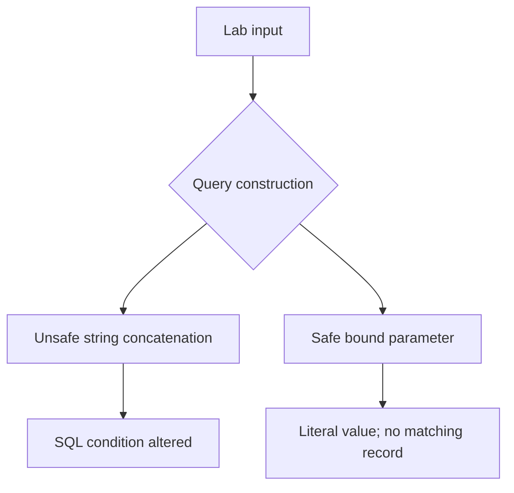

# SQL Injection: Vulnerable vs Parameterized Queries

**Type:** Local educational security lab. **Scope:** Only the temporary in-memory SQLite database created by this repository. No external targets.

## Objective
Compare unsafe SQL string interpolation with bound parameters and demonstrate how a query changes when user-controlled input is treated as executable SQL.

## Run
Python 3.10+; no dependencies.

```bash
python lab.py
python -m unittest discover -s tests -v
```

## Findings and remediation

The vulnerable demonstration builds a query by concatenating the supplied username. The controlled lab input `' OR '1'='1` changes the WHERE condition and causes additional demonstration records to match. The fixed implementation uses a `?` placeholder, treating the entire input as literal data. The automated test checks that the payload returns no rows in the fixed version.

**Risk:** In real software, SQL injection can bypass application logic or expose data, depending on privileges and query context. **Mitigation:** Parameterized queries, least-privilege database accounts, input validation for business constraints, and tests.

**Limitations:** This is a deterministic local SQLite proof-of-concept, not a penetration test of a deployed application. Capture personal execution screenshots before presenting results as personally performed.

## Architecture



## Security finding — SQLI-001

| Field | Assessment |
|---|---|
| Asset | Local, temporary SQLite `users` table |
| Weakness | SQL query assembled with untrusted input |
| Reproduction | Run `python lab.py` and compare injected lookups |
| Impact in this lab | All three synthetic accounts match an injected predicate |
| Severity | Educational example; no real-world severity assigned |
| Fix | Bound query parameters, demonstrated by `safe_lookup` |
| Verification | Regression test checks injected string returns zero matches |

This is a **reproducible lab finding**, not a claim of discovering a flaw in a third-party application.

## Evidence checklist

- [ ] Run both implementations and save terminal output screenshot
- [ ] Run the tests and save passing results
- [ ] Explain why parameterization prevents the injection
- [ ] Add one original test and commit it

## GitHub summary
Local SQLite lab showing a reproducible SQL injection flaw, fixed query, and regression tests.
